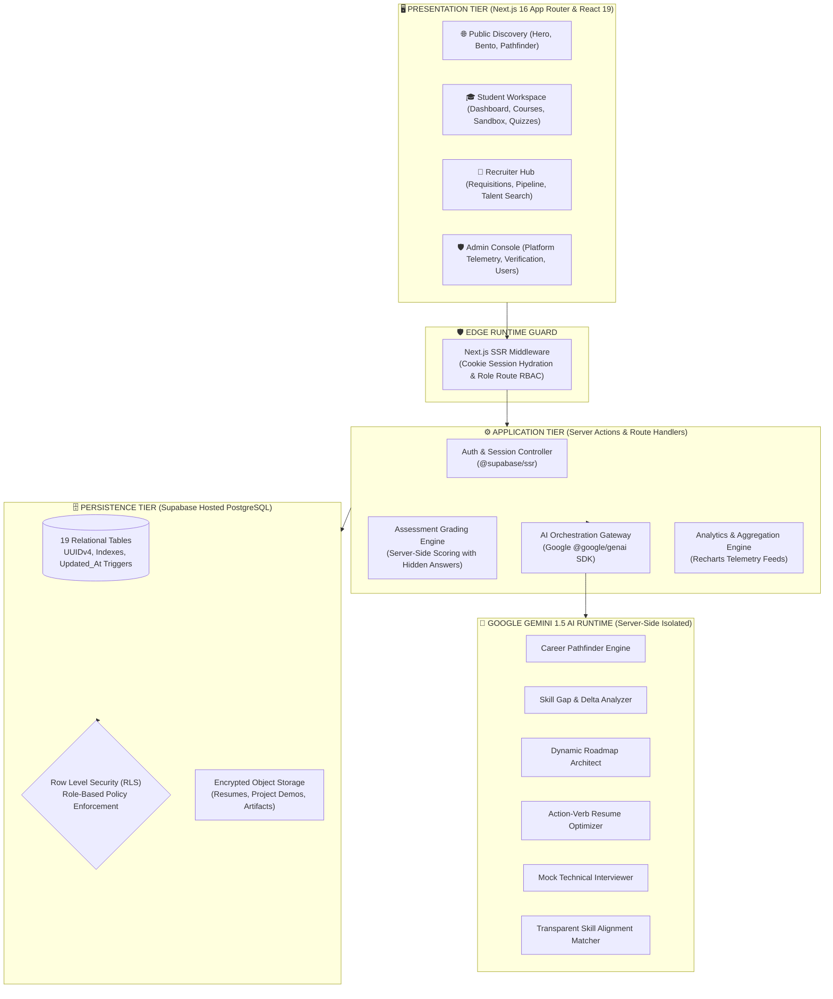
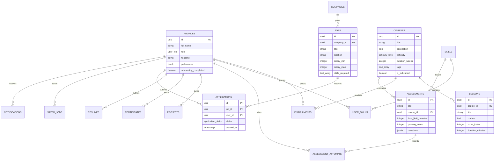

<div align="center">

# ⚡ UnlockED
### *Learn skills. Build projects. Prove your potential. Unlock opportunities.*

[](https://nextjs.org/)
[](https://react.dev/)
[](https://www.typescriptlang.org/)
[](https://tailwindcss.com/)
[](https://supabase.com/)
[](https://ai.google.dev/)
[](https://vercel.com/)
[](./LICENSE)

<br/>

<p align="center">
  <b>A production-grade, AI-powered education and career platform engineered to transform non-traditional learners into verifiable senior software engineers and connect them directly with top-tier hiring partners.</b>
</p>

<p align="center">
  <a href="#-system-architecture">Architecture</a> •
  <a href="#-interactive-visual-showcase">Visual Tour</a> •
  <a href="#-core-capabilities-by-persona">Roles & Features</a> •
  <a href="#-database-architecture--erd">Database ERD</a> •
  <a href="#-server-side-gemini-ai-engine">AI Microservices</a> •
  <a href="#-quickstart-guide">Quickstart</a> •
  <a href="#-security--row-level-security-rls">Security & RLS</a>
</p>

---

</div>

<br/>

## 🌌 The Obsidian Kinetic Design Identity

Engineered strictly against the official **Google Stitch Project [#6434954933055708230](https://stitch.google.com/projects/6434954933055708230)**:
* **Dual Luminous Paradigms**: A clean, elegant high-discovery landing experience transitioning smoothly into deep obsidian charcoal workspaces engineered for tangible coding momentum and flow states.
* **Color Spectrum**:
  | Color Name | Hex Token | Visual Role |
  | :--- | :--- | :--- |
  | **Obsidian Void** | `#0B0B12` | Foundation viewport background |
  | **Obsidian Raised** | `#12121D` | Primary card and workspace surface |
  | **Hairline Stroke** | `#232338` | Structural micro-borders |
  | **Kinetic Violet** | `#8B5CF6` | Primary brand accent & focus rings |
  | **Electric Indigo** | `#6366F1` | Secondary gradient telemetry highlight |
  | **Emerald Verification** | `#22C55E` | Cryptographic pass marks & mastery status |
* **Typography**: Tight optical kerning via Inter with tracking calibrated between `-0.03em` on display typography and `-0.01em` on code blocks.

---

## 🏛️ System Architecture

UnlockED is architected with strict separation of concerns, zero-trust server boundaries, and full edge-ready reactivity.



---

## 📸 Interactive Visual Showcase

<div align="center">

| 🎓 Student Dashboard & Skill Radar | ⚡ AI Career Pathfinder & Roadmap |
| :---: | :---: |
|  |  |
| *Real-time career readiness index (88/100), verified skill matrices, active courses, and upcoming interviews.* | *Multi-turn career counseling, structured gap diagnosis, and interactive milestone roadmaps.* |

| 🤖 AI Mock Interview & Resume Architect | 💼 Recruiter Pipeline & Candidate Search |
| :---: | :---: |
|  |  |
| *Simulated senior engineering interviews with transparent rubrics and instant ATS-ready resume scoring.* | *Search pre-assessed talent, filter by verified repository code links, and manage multi-stage pipelines.* |

</div>

---

## 🎯 Core Capabilities by Persona

### 1. 🎓 Student Experience (`/student`)
* **Live Telemetry Dashboard**: Career Readiness Score (88/100), verified competency radar, enrolled courses, and pending applications.
* **Curriculum & Lesson Sandboxes**: Full-featured courses in *High-Concurrency Go*, *Production AI Systems*, *DevOps/Kubernetes*, and *Modern React 19*.
* **Cryptographic Assessments**: Timed MCQ exams where question answers are **scored exclusively on the server**—client bundles never receive answer keys.
* **AI Career Pathfinder**: Tailored roadmaps mapping target engineering positions to concrete missing competencies.
* **AI Mock Technical Interview**: Interactive voice/text simulation grading answers against Google/Amazon-style technical bar rubrics.
* **Interactive Resume Architect**: ATS-optimized resume builder with action-verb suggestions and instant PDF export.
* **Public Verified Portfolio (`/portfolio/[username]`)**: Cryptographically verified talent showcase with code repository links, live demos, and mastery verification tags.
* **Job Board with Anti-Spam Safeguards**: One-click applications with automated duplicate prevention and status telemetry.

### 2. 💼 Recruiter Hub (`/recruiter`)
* **Talent Sourcing Engine**: Filter pre-assessed candidates by verified skill tags (Golang, Kubernetes, PyTorch, Vector Search).
* **Code Proof Inspection**: Review candidates' actual GitHub repos and live production deployments without third-party screening calls.
* **Requisition Management (`/recruiter/jobs/new`)**: Publish salary-transparent job opportunities with remote work policies and skill requirements.
* **Hiring Kanban Pipeline**: Drag-and-drop or 1-click status transitions (*Reviewed* ➔ *Shortlisted* ➔ *Interview* ➔ *Offered*).
* **Company Brand Profile**: Manage hiring partner profiles, engineering team values, and benefits.

### 3. 🛡️ Admin Control Center (`/admin`)
* **Executive Telemetry & Recharts**: Real-time graphs for monthly active talent, placement conversion, and skill growth distributions.
* **User & Role Governance (`/admin/users`)**: Server-validated role switching (*Student*, *Recruiter*, *Admin*). Public registration cannot grant elevated access.
* **Course Moderation**: Curate, draft, or publish technical tracks and modules.
* **Job Quality & Salary Compliance**: Moderation workflow protecting candidates from predatory or fraudulent postings.
* **Recruiter Verification**: Strict verification gates before hiring partners can view student contact profiles.

---

## 🗄️ Database Architecture & ERD

The application utilizes **19 relational PostgreSQL tables** configured with strict foreign keys, cascading rules, optimized composite indexes, and automated `updated_at` triggers.



---

## 🤖 Server-Side Gemini AI Engine

Every AI feature is executed strictly on the server through official `@google/genai` harnesses. The client never communicates directly with LLM endpoints, preventing prompt leakage and credential exposure.

```
┌────────────────────────────────────────────────────────────────────────┐
│                      UnlockED AI Service Layer                         │
├──────────────────────┬────────────────────────┬────────────────────────┤
│ Microservice         │ Model & Temperature    │ Validation Schema      │
├──────────────────────┼────────────────────────┼────────────────────────┤
│ Career Assistant     │ Gemini 1.5 Pro (0.4)   │ Zod CareerPlanSchema   │
│ Skill Gap Analyzer   │ Gemini 1.5 Flash (0.2) │ Zod SkillGapSchema     │
│ Personalized Roadmap │ Gemini 1.5 Pro (0.3)   │ Zod RoadmapSchema      │
│ Mock Interviewer     │ Gemini 1.5 Flash (0.4) │ Zod InterviewFeedback  │
│ Resume Architect     │ Gemini 1.5 Flash (0.3) │ Zod ResumeSuggestion   │
│ Job Match Engine     │ Gemini 1.5 Flash (0.1) │ Zod JobMatchScore      │
└──────────────────────┴────────────────────────┴────────────────────────┘
```

> [!IMPORTANT]
> **Zero-Hallucination Guardrail**: The AI Resume Assistant is strictly forbidden by prompt harness rules from inventing unearned credentials, degrees, or metrics. Every suggestion is framed around active voice and impact metrics.

---

## 🔒 Security & Row Level Security (RLS)

UnlockED implements defense-in-depth security principles:
* **Row-Level Security (RLS)**: Enforced directly at the PostgreSQL layer. Even if an API route had a vulnerability, Postgres rejects unauthorized queries.
* **Answer Secrecy**: Correct answers for quizzes and benchmarks are stored exclusively in the database and evaluated server-side.
* **Anti-Spoofing Admin Onboarding**: Admin accounts cannot be created via public signups. The initial platform superuser is seeded through a protected server-side utility.
* **CSRF & Cookie Protection**: Session tokens are encrypted inside `httpOnly`, `sameSite=lax`, `secure` cookies managed via `@supabase/ssr`.

---

## 🚀 Quickstart Guide

### 1. Clone & Install Dependencies
```bash
git clone https://github.com/meetukani34-prog/unlockED.git
cd unlockED
npm install
```

### 2. Configure Environment Variables
Create `.env.local` by copying the template:
```bash
cp .env.example .env.local
```

Populate the required credentials:
```env
NEXT_PUBLIC_APP_URL=http://localhost:3000
NEXT_PUBLIC_APP_NAME=UnlockED

# Google Gemini AI (Server-Side)
GEMINI_API_KEY=your_gemini_api_key

# Supabase PostgreSQL + Auth
NEXT_PUBLIC_SUPABASE_URL=https://your-project.supabase.co
NEXT_PUBLIC_SUPABASE_ANON_KEY=your-publishable-key
SUPABASE_SERVICE_ROLE_KEY=your-service-role-key
```

### 3. Initialize Database Migrations
Open your **Supabase Dashboard** ➔ **SQL Editor**, and execute:
```sql
-- Run the unified migration script
supabase/full_setup.sql
```

### 4. Run the Development Server
```bash
npm run dev
```
Open **[http://localhost:3000](http://localhost:3000)** in your browser to experience the platform.

---

## 🧪 Verification & Testing

Run the full validation suite:

```bash
# TypeScript strict type check
npx tsc --noEmit

# Production build test
npm run build

# Code style linting
npm run lint
```

---

## 🗺️ Engineering Horizons (Roadmap)

- [x] **Phase 1**: Architecture, Obsidian Kinetic Design Tokens & Database Migration
- [x] **Phase 2**: Dual Auth Flow (SSR Supabase + Interactive Local Demo Engine)
- [x] **Phase 3**: Server-Side Google Gemini AI Microservices (Career, Roadmap, Mock Interview)
- [x] **Phase 4**: Course Curriculum, Interactive Sandboxes & Cryptographic Assessments
- [x] **Phase 5**: Recruiter Talent Pipeline, Code Proof Review & Requisition Manager
- [x] **Phase 6**: Platform Admin Console, Recharts Telemetry & Moderation Workflows
- [ ] **Phase 7**: Live Real-Time WebRTC Peer Coding Sandboxes
- [ ] **Phase 8**: Smart Contract Attestation of Completed Degree Equivalencies

---

<div align="center">

Made with 💜 by **Meet Ukani** for next-generation engineers worldwide.

[](https://github.com/meetukani34-prog/unlockED)
[](https://github.com/meetukani34-prog/unlockED)

</div>
# unlockED

