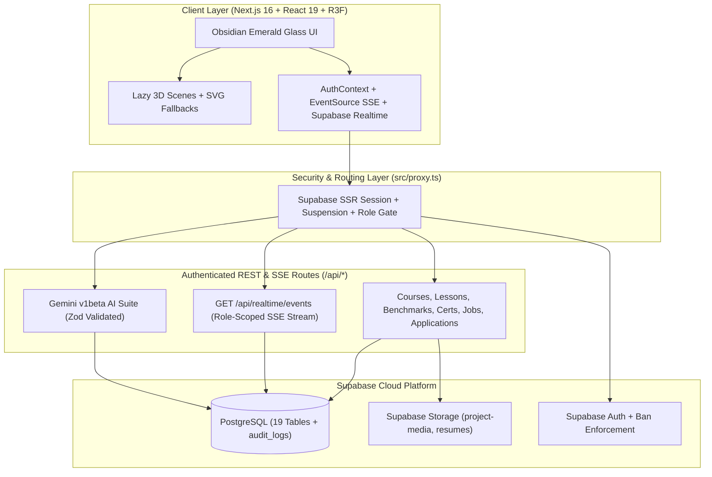
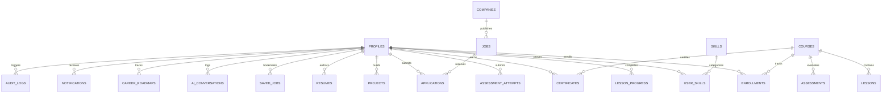

# ⚡ UnlockED

### *Learn skills. Build projects. Prove your potential. Unlock opportunities.*

[](https://nextjs.org/)
[](https://react.dev/)
[](https://threejs.org/)
[](https://www.typescriptlang.org/)
[](https://tailwindcss.com/)
[](https://supabase.com/)
[](https://ai.google.dev/)
[](https://vercel.com/)

An immersive, interactive 3D, AI-powered education-to-employment platform built with **Next.js 16 (App Router)**, **React Three Fiber**, **Supabase PostgreSQL + SSR Auth + Storage**, and **Google Gemini AI**.

**Live Production:** [unlock-ed-one.vercel.app](https://unlock-ed-one.vercel.app/)

[Architecture](#system-architecture) · [3D Experience](#interactive-3d-environments) · [Role Workspaces](#role-based-ecosystems) · [Database Schema](#database-architecture) · [AI Services](#ai-intelligence-suite) · [Quickstart](#local-development--deployment)

---

## Visual Identity & Design System

UnlockED uses a unified **Obsidian Emerald & Cyan Glass** design system across every public, student, recruiter, and administrative route:

- **Canvas & Layered Surfaces:** Deep obsidian `#06100C`, elevated forest panels `#07130E`, translucent glass containers `#0A1913`, structural hairlines `#143326` / `#16382C`
- **Primary & Secondary Accents:** Cyber Mint `#00DC82`, Neon Emerald `#10B981`, Electric Cyan `#22D3EE`, Amber Governance `#F59E0B`
- **Accessibility & Motion:** Adaptive WebGL detection with accessible SVG/CSS fallbacks (`CanvasShell`) and automatic `prefers-reduced-motion` support

---

## Interactive 3D Environments

Every major section integrates lazy-loaded (`next/dynamic`, `ssr: false`) **Three.js / `@react-three/fiber`** scenes connected directly to live application state and routing:

1. **Homepage Knowledge Constellation (`src/components/3d/knowledge-network-scene.tsx`)**
   - Orbitable 3D curriculum & ecosystem graph connecting live courses, skill benchmarks, and the recruiter pipeline. Clicking any 3D node updates the live inspector card and navigates directly to its track or hub.
2. **Student Skill Constellation (`src/components/3d/skill-constellation-scene.tsx`)**
   - Driven strictly by the authenticated student's PostgreSQL enrollments, completion percentages, and verified skills.
3. **Recruiter Talent Funnel (`src/components/3d/talent-funnel-scene.tsx`)**
   - Interactive 3D pipeline rings mapping real counts across *Talent Pool → Applied/Reviewed → Shortlisted → Interviewed → Offered* to filter the live applicant queue.
4. **Admin Governance Topology (`src/components/3d/admin-telemetry-scene.tsx`)**
   - Real-time cluster visualization across *Identity & RBAC*, *Curriculum & Certs*, *Hiring Compliance*, and *Portfolio & Audit*.

---

## System Architecture



---

## Role-Based Ecosystems

### Public Discovery (`/`, `/courses`, `/verify/[code]`, `/portfolio/[username]`)
- **3D Universe Homepage (`/`)**: Interactive 3D knowledge network, `Learn → Build → Connect` workflow explorer, live track cards, and direct credential code verification lookup.
- **Public Course Catalog (`/courses`, `/courses/[id]`)**: Searchable and filterable catalog backed by normalized Supabase UUID tracks.
- **Credential Verification (`/verify/[code]`)**: Live PostgreSQL verification for issued `UED-YYYY-XXXXXXXX` certificates.
- **Shareable Portfolios (`/portfolio/[username]`)**: Public showcase of published student projects, verified skills, and issued certificates (respecting user privacy settings).

### Student Learning Universe (`/student`)
- **Dashboard (`/student`)**: Interactive 3D Skill Constellation, active study day tracking derived from DB timestamps, benchmark average, and recommended tracks.
- **Course Workspace & Challenge Sandbox (`/student/courses/[id]/lessons/[lessonId]`)**: Multi-section theory, code examples, knowledge checks, and an origin-isolated `<iframe sandbox="allow-scripts">` JS execution runner & structural checker.
- **Server-Scored Benchmarks (`/student/assessments/[id]`)**: Timed exams where answer keys remain strictly server-side; passing updates `user_skills` and unlocks track certificates once 100% of modules are complete.
- **AI Career Studio (`/student/ai-assistant`)**: Context-aware Career Trajectory Chat, AI Mock Interview Simulator, and Skill Gap Diagnostics.
- **Career Roadmap (`/student/roadmap`)**: AI-generated phase roadmaps persisted to `career_roadmaps` with interactive milestone status toggles.
- **Portfolio & Resume Builder (`/student/portfolio`, `/student/resume`)**: Full project CRUD with Supabase Storage image uploads, AI portfolio critique, multi-section resume editing, and downloadable `jsPDF` generation.
- **Jobs & Applications (`/student/jobs`)**: Skill-overlap match explanations, `INR` / `USD` compensation formatting, saved jobs, and real-time application status tracking.

### Recruiter Talent Hub (`/recruiter`)
- **Talent Hub (`/recruiter`)**: Interactive 3D Hiring Funnel filtering live applicant queues across stages.
- **Company Profile & Requisitions (`/recruiter/company`, `/recruiter/jobs`, `/recruiter/jobs/new`)**: Full job posting management with verified partner badges.
- **Candidate Discovery & Comparison (`/recruiter/candidates`)**: Filter learners by skill, project, or location, and compare up to 3 candidates side-by-side.
- **Application Pipeline (`/recruiter/applications`)**: Stage filtering, one-click status updates (`reviewed`, `shortlisted`, `interviewed`, `offered`, `rejected`), and persistent interview slot scheduling + recruiter notes that trigger instant student notifications.

### Admin Control Room (`/admin`)
- **Control Room (`/admin`)**: Interactive 3D Governance Topology, partner review alerts, and live audit log filtering.
- **Platform Analytics (`/admin/analytics`)**: Time-windowed telemetry (`7` / `30` / `90` / `365` days) queried directly from PostgreSQL.
- **Governance & Moderation (`/admin/users`, `/admin/courses`, `/admin/jobs`, `/admin/recruiters`, `/admin/projects`, `/admin/notifications`)**: Immediate user suspension/reactivation (enforced across Auth, Proxy, APIs, and SSE), course publishing, partner verification, project moderation, and searchable Audit Event Explorer.

---

## Database Architecture

The PostgreSQL schema in `supabase/full_setup.sql` plus `supabase/migrations/003_platform_hardening.sql` includes **19 core relational tables** plus **`audit_logs`**, Row Level Security (RLS), and Realtime publication rules:



---

## AI Intelligence Suite

Server-side AI endpoints live in `src/app/api/ai/*`, enforce authenticated access + per-user rate limiting, validate outputs strictly with **Zod**, persist history to PostgreSQL, and return explicit HTTP `503` responses (never fabricated fallback answers) if upstream providers fail:

| Endpoint | Engine Helper | Purpose |
| :--- | :--- | :--- |
| `POST /api/ai/career-assistant` | `src/lib/ai/career-assistant.ts` | Profile-grounded career recommendations & project feedback |
| `POST /api/ai/mock-interview` | `src/lib/ai/mock-interview.ts` | Role-calibrated interview question generation & evaluation |
| `POST /api/ai/skill-gap` | `src/lib/ai/skill-gap.ts` | Target-role skill coverage diagnostics & missing skill breakdown |
| `POST /api/ai/roadmap` | `src/lib/ai/roadmap.ts` | Persisted multi-phase study roadmap generation & milestone updates |
| `POST /api/ai/resume-assistant` | `src/lib/ai/resume-assistant.ts` | Role-tailored resume summary & bullet point enhancement |

---

## Security & Real-Time Safeguards

- **Next.js 16 Auth Proxy (`src/proxy.ts`):** Validates real Supabase SSR sessions on every protected route; public registration can never elevate to `admin`.
- **Hardened Admin Bootstrap (`POST /api/admin/seed`):** Requires `ADMIN_INIT_SECRET` ($\ge 16$ characters) checked via `crypto.timingSafeEqual`; fails closed (`503`) if unconfigured.
- **Live Suspension Revocation:** Suspending a user updates Supabase Auth `ban_duration` and revokes active `/api/me` and `/api/realtime/events` SSE streams immediately.
- **Role-Scoped Real-Time Sync:** Combines Supabase Realtime `postgres_changes` channels with an authenticated SSE digest stream (`/api/realtime/events`) for immediate cross-role updates without page reloads.

---

## Local Development & Deployment

### 1. Prerequisites
- Node.js 20+
- A Supabase project (PostgreSQL + Auth + Storage)
- A Google Gemini API key (`GEMINI_API_KEY`)

### 2. Installation & Database Setup
```bash
git clone https://github.com/ukanimeet42-creator/unlockED.git
cd unlockED
npm install
```

1. Copy `.env.example` to `.env.local` and configure:
   ```env
   NEXT_PUBLIC_APP_URL=http://localhost:3000
   NEXT_PUBLIC_SUPABASE_URL=https://your-project.supabase.co
   NEXT_PUBLIC_SUPABASE_ANON_KEY=your-supabase-anon-key
   SUPABASE_SERVICE_ROLE_KEY=your-supabase-service-role-key
   GEMINI_API_KEY=your-gemini-api-key
   ADMIN_INIT_SECRET=your_min_16_char_bootstrap_secret
   ```
2. Run `supabase/full_setup.sql` followed by `supabase/migrations/003_platform_hardening.sql` in your Supabase SQL Editor.
3. Ensure Storage buckets `project-media` (public) and `resumes` (private) exist in Supabase Storage.

### 3. Verify & Run Locally
```bash
npx tsc --noEmit
npm run lint
npm run build
npm run dev
```

### 4. Vercel Deployment
Set the same environment variables in your Vercel Project Settings (`NEXT_PUBLIC_APP_URL=https://unlock-ed-one.vercel.app`) and deploy via GitHub push or `npx vercel --prod`.

---

Built by **Meet Ukani** · **Team SARVAM** · [ukanimeet42-creator/unlockED](https://github.com/ukanimeet42-creator/unlockED)
